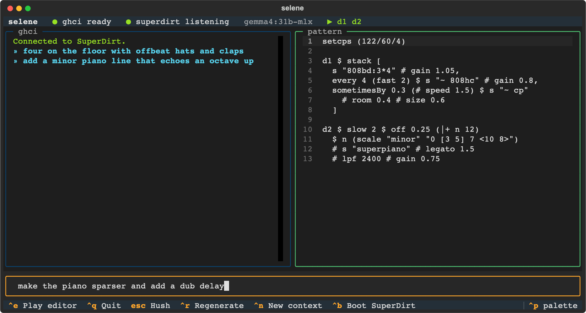

# selene

Describe music in words; a local LLM writes [TidalCycles](https://tidalcycles.org)
patterns and plays them through SuperCollider + SuperDirt.



Type *"slow dubby techno with a deep kick and offbeat hats"*, and selene asks a
local [Ollama](https://ollama.com) model for Tidal code, sends it to a GHCi
running Tidal (the same way Pulsar's TidalCycles plugin does), and it starts
playing. Follow-up prompts revise what's playing: *"add a minor piano line on
d2"*, *"half-time the drums"*, *"make it sparser"*.

- **Code you can edit.** The generated pattern lands in an editor; tweak it and
  press `ctrl+e` to play your version, or play just the layer under the cursor
  the way Pulsar does (`ctrl+enter`, or `ctrl+j`) while the others keep going.
  Played code flashes green (red if GHCi rejects it).
- **Event highlighting.** As in Pulsar, each mini-notation token in the editor
  lights up while it sounds.
- **Self-correcting.** If GHCi rejects the code, the error goes back to the
  model (up to twice) with a hint about the likely mistake. The previous
  pattern keeps playing until something valid arrives.
- **Grounded in your install.** The model is told which Dirt-Samples banks and
  SuperDirt synths you actually have, and code naming sounds you don't have is
  sent back for a fix before it plays.
- **Everything local.** No cloud APIs; default model is `gemma4:31b-mlx` (`gemma4:31b` off Apple silicon).
- **Swap models.** `ctrl+k` lists your installed Ollama models with their
  size, parameters, quantization and which are in memory; pick one and it
  loads straight away. The top bar's model light is green when it's ready,
  yellow while it checks or loads, and red if Ollama is down or the model
  isn't installed.
- **Lanes.** A row per orbit shows what it plays across the current phrase
  (4 cycles), wiping like a tracker: hits shaded by level, synth notes as
  letters, the previous pass dimmed ahead of the playhead, and the sounds
  each layer played listed after it. Flow's drops, rolls and thinning are
  visible as they happen. `ctrl+l` hides it.
- **Mute by clicking or by key.** Each lane's `d1 d2 d3` chip (in the top bar
  when the lanes are hidden) lights up on every hit: click to mute/unmute,
  shift-click to solo. `option+1`–`9` (or Pulsar's `ctrl+1`–`9`) toggle
  `d1`–`d9`, and `option+0` / `ctrl+0` unmutes everything. Mutes survive the
  model revising the pattern; `esc` clears them.
- **Flow mode.** `ctrl+f` lets the music play itself, from slow drift to
  drops, fills and rhythm mutations on the beat, as active as you set it with
  `/flow 1`–`5`. Off until you turn it on. See [Flow](#flow).
- **Record to WAV.** `ctrl+g` records what SuperCollider plays, starting
  and stopping on the beat. See [Recording](#recording).
- **Play it in.** Plug in a MIDI keyboard, play a riff along with what's
  playing, and `ctrl+y` writes it into the editor as a new layer, on the beat.
  See [MIDI keyboard](#midi-keyboard).
- **Session log.** Every pattern that plays is appended to
  `~/.local/share/selene/<date>.tidal`, and every prompt you type is kept
  (`↑` reaches back across launches).

## Requirements

selene runs on macOS. (Linux and Windows aren't supported yet, but its setup
checks already know where things live there.)

- **Python 3.11+** and [uv](https://docs.astral.sh/uv/)
- **GHC + Tidal**: follow the official TidalCycles guide for
  [macOS](https://tidalcycles.org/docs/getting-started/macos_install),
  [Linux](https://tidalcycles.org/docs/getting-started/linux_install) or
  [Windows](https://tidalcycles.org/docs/getting-started/windows_install)
  (tested with GHC 9.14.1, Tidal 1.10.3). If ghcup left `ghci` off your
  `PATH`, selene finds it in `~/.ghcup/bin` anyway.
- **SuperCollider + SuperDirt**: covered by the same guide (SuperDirt is the
  `Quarks.install("SuperDirt")` step). [sc3-plugins](https://supercollider.github.io/sc3-plugins/)
  are optional and add the extra `super*` synths.
- **[Ollama](https://ollama.com/download)** with a model pulled. The default is
  Gemma 4 31B: `ollama pull gemma4:31b-mlx` on Apple silicon, `ollama pull gemma4:31b`
  elsewhere (about 19 GB). Any model works; see `--model` and `ctrl+k`.

At launch selene checks for all of this. If something's missing it says
what, with a button that opens the official instructions for your platform
(the command to run, when there is one, is shown too). `/setup` checks again,
for example after you've installed something.

## Run

```sh
git clone https://github.com/jeffehobbs/selene && cd selene
uv run selene                # offers to start SuperDirt if it isn't running
uv run selene --superdirt    # starts it without asking
```

Or install it as a command: `uv tool install git+https://github.com/jeffehobbs/selene`.

## Keys

| key | |
|---|---|
| `enter` | generate from the prompt and play |
| `ctrl+e` | play the editor contents |
| `ctrl+enter` or `ctrl+j` | play the statement under the cursor; other layers play on |
| `shift+enter` or `ctrl+\` | play only the line under the cursor |
| `option+1`–`9` or `ctrl+1`–`9` | mute / unmute `d1`–`d9` |
| `option+0` or `ctrl+0` | unmute everything |
| `esc` | hush (also cancels a generation) |
| `ctrl+r` | regenerate the last prompt |
| `ctrl+n` | new context: next prompt ignores what's playing |
| `ctrl+f` | Flow on / off (`/flow 1`–`/flow 5` sets how active) |
| `ctrl+s` | save the editor to a `.tidal` file (asks for a name the first time) |
| `ctrl+o` | open a `.tidal` file into the editor (doesn't play it until `ctrl+e`) |
| `ctrl+l` | lanes on / off |
| `ctrl+t` | your preferences for the model (also the footer's Prefs button) |
| `ctrl+k` | pick the model from the ones Ollama has installed |
| `ctrl+b` | boot SuperDirt |
| `ctrl+y` | write what you just played on the MIDI keyboard as a new layer |
| `ctrl+g` | record to WAV: start / stop on the next phrase (also the footer's Rec button, which reads Stop Rec while recording) |
| `ctrl+q` | quit (hushes, stops anything selene started) |
| `↑` / `↓` | prompt history, across launches |
| drag the divider | resize the ghci log / pattern panels (double-click: back to 50/50) |
| click `dN` | mute / unmute that orbit |
| shift-click `dN` | solo that orbit (again to un-solo) |

`ctrl+enter`, `shift+enter` and `ctrl+digit` are Pulsar's keys, but only
terminals that report them get them (kitty, Ghostty, WezTerm, iTerm2 with
"Report modifiers using CSI u"). Apple's Terminal can't send them, so
`ctrl+j`, `ctrl+\` and `option+digit` do the same jobs. `option+digit` works
whether or not "Use Option as Meta key" is on. The catch is that the
characters option+digit normally types (`¡ ™ £ ¢ ∞ § ¶ • ª º` on a US
keyboard) can't be typed in selene.

In the prompt, `!` sends raw Tidal (`!d3 $ s "cp*4"`), and `/hush`, `/cps 0.6`,
`/bpm 128`, `/mute 2`, `/unmute` (all), `/solo 1`, `/fade 4 [CYCLES]`,
`/fade all`, `/stop 4`, `/take 4`, `/prefs`, `/prefer TEXT`, `/flow`, `/split 30` (the log's share of the width; `/split`
resets), `/save [NAME]`, `/open [NAME]`, `/record`, `/sounds` (see [Soundsets](#soundsets)), `/midi` (see [MIDI keyboard](#midi-keyboard)), `/capture`, `/model [NAME]` (no name: the picker), `/clear` (empties the ghci log), `/quiet` (see below), `/setup` (checks what's installed), `/new`
are commands (`/record tail N` sets the ring-out, `/record dir PATH` the folder,
`/record video on|off` films Selene's window too).
The split, whether the lanes are showing, the quiet log, the model you last picked, and
where recordings go and how long they ring out are
remembered between launches (`~/.local/share/selene/settings.json`). Every
prompt you've typed is in `~/.local/share/selene/prompt_history.jsonl`.

**Quiet log.** Like Pulsar's "only show log on errors", the log hides
GHCi's and SuperCollider's routine output (the boot banner, `Listening for…`,
the `sc` lines). Green lines (`Connected to SuperDirt`), errors and selene's
own messages still show. `/quiet` turns it off and back on, redrawing the
log with or without the hidden lines, and selene remembers the choice.

**Held layers.** Like Tidal itself, playing new code doesn't stop layers it
doesn't mention: open a file with `d1`–`d3` over one with `d1`–`d6` and
`d4`–`d6` keep going, DJ-style. They stay in the lanes below a *held* divider
(amber chips; hover for where they came from), mute and solo like any layer,
and the model knows they're there. `/fade 4` crossfades one out over 8
cycles (`/fade 4 16` over 16; `/fade d4 d5` for several), `/stop 4` cuts it
on the next cycle, `/fade held` / `/stop held` do all the held ones, and
`/take 4` pulls its code back into the editor to work on.

`/fade all` fades *everything* out, current and held, over 8 cycles (or
`/fade all 16`), turning Flow off and ending like `esc`: silent, with your
code still in the editor for `ctrl+e`. Playing anything mid-fade cancels the
silence at the end; `esc` still cuts straight to it.
Anything selene hears playing that it didn't start gets a held lane too.

Files live in `~/Documents/selene` unless you pass `--dir`; a bare name means
`NAME.tidal` there. The editor's title shows the open file, with `•` when it
has unsaved changes. Replacing a different file, or opening over edits that
are neither saved nor playing, asks first.

**Your preferences.** `/prefer prefer 808 kits` adds a line to your
preferences; `/prefs`, `ctrl+t` or the Prefs button in the footer opens them
all for editing (`ctrl+s` saves). They're
appended to the model's system prompt, last so they win over its defaults,
for prompts and Flow's rewrites alike, from the next request on. They live
in `~/.local/share/selene/preferences.md`; the built-in prompt (sound lists,
syntax rules) stays as it is.

Edits you make in the editor are the base for your next prompt even if you
haven't played them yet, so you can sketch a change and ask the model to run
with it.

## MIDI keyboard

selene listens to the first MIDI keyboard it finds (plugging one in or out is
noticed within a few seconds), and the top bar shows `♪` and its name. The
keys sound through SuperDirt as you play, in `supersquare` unless you change it.

Play along with what's playing, then press `ctrl+y` (or `/capture`). The
phrase you just played, meaning everything since the last pause of a cycle or
more, is placed on Tidal's grid and written into the editor as the next free
`dN`:

```haskell
d2 $ n "<[c5 ds5 [g5 as5] ~] [c6 ~ g5 ~]>" # s "supersquare" # sustain 0.15
```

- The phrase starts on the cycle where you played your first note (a note a
  little early still counts as the downbeat). It lasts 1, 2 or 4 cycles; past
  4, the last 4 are kept.
- Each cycle gets the grid that fits it best: quarters, 8ths, 16ths or
  triplets. Light swing stays on 8ths. Keys struck together become a chord
  (`[c5,e5,g5]`), and the sustain pedal counts.
- A long phrase is written a cycle per line, as `n (cat ["…", "…"])`
  (the same as `"<… …>"`), with each `#` on its own line.
- `# gain` follows your velocity only if you played with some dynamics.
  `# sustain` is how long you typically held the keys.
- It doesn't play until you play it (`ctrl+j` with the cursor on it, which is
  where it lands). Because unplayed edits are what your next prompt builds on,
  you can also just ask: *"build a dubby track around this riff"*.

The notes are placed against the beat Tidal is playing, so something has to
be playing. If nothing is, `/midi click` starts a quiet hi-hat on `d12` to
play along with, and it stops once you capture.

| command | |
|---|---|
| `/midi` | the keyboard in use, its settings and the MIDI ports there are |
| `/midi NAME` | use that port (part of its name is enough); remembered |
| `/midi sound supersaw` | what the keys play (and what a capture uses) |
| `/midi offset 20` | if your notes land late, the milliseconds to take off them |
| `/midi click` | metronome on/off |
| `/midi off`, `/midi on` | stop / start listening |

`--midi NAME` picks the port for one run.

## Recording

`ctrl+g` (or `/record`) records SuperCollider's output to a 24-bit WAV.
While something is playing it starts on the next phrase boundary (every
4 cycles) and stops on one when you press it again, so takes start on the
downbeat. With nothing playing it starts and stops at once. Pressing it
again before the take starts calls it off. The top bar shows `● rec 1:23`
while recording; quitting closes the file properly.

A take doesn't end dead on the beat. After the stop point it keeps
recording so reverb and delay can ring out, and finishes once the output has
been silent for half a second, or after 8 seconds at most. So fading out
(`/fade all`) or pressing `esc`, then `ctrl+g`, ends the take on its natural
tail. If the music is still playing, the take simply runs up to 8 seconds
longer. `/record tail 15` changes the maximum; `/record tail 0` cuts exactly
on the beat.

Takes are saved next to your `.tidal` files (`~/Documents/selene`, or wherever
you last saved or opened one), named after the open file:
`dub-2026-10-05-213012.wav`. `/record dir ~/Music/takes` sends them elsewhere;
`/record dir` alone goes back to the `.tidal` folder.

**Video takes.** `/record video on` makes every take also film Selene's own
window. After the take, Selene saves an MP4 next to the WAV
(`dub-2026-10-05-213012.mp4`) with the WAV as its soundtrack, so the sound is
SuperDirt's clean recording, not the speakers. It's in sync to within a
frame: as a take arms, the top bar flashes magenta for a moment, and Selene
finds that flash in the film to line it up with the sound (the flash itself
is cut). It needs macOS's Terminal app and `ffmpeg` (`brew install ffmpeg`).
The first take asks for Screen Recording permission for Terminal. Keep
Selene's window in front while recording; with Stage Manager, a window in
the side strip films as its thumbnail. `/record video off` goes back to sound
only.

SuperCollider's own recorder does the writing, which needs a few lines of
code inside sclang:

- **If selene started SuperCollider** (`--superdirt`, `ctrl+b`, or yes to
  the offer at launch), it adds them itself. Nothing on disk changes.
- **If SuperCollider was already running**, the first `ctrl+g` asks to add them
  to your `startup.scd`. Selene backs it up as `startup.scd.selene-bak` and
  adds a marked block at the end (`// >>> selene recorder` … `// <<< selene
  recorder`; delete it to remove the recorder). The same block also loads
  [soundsets](#soundsets), so whichever of the two you set up first covers both. It then restarts that
  SuperCollider so the code loads, and starts recording. Sound drops for a
  few seconds, and if the SuperCollider IDE was running it, the IDE's
  interpreter stops.

## Soundsets

`/sounds` lists Selene's sound packs and installs them from inside the app:
Enter installs (or updates) the highlighted pack, and Remove deletes one
after asking. A pack loads into SuperDirt right away, with no restart, and
again every time SuperDirt starts. The model is told what each new sound is
and which knobs it takes.

**Selene Rhythm** (8.9 MB) is modular-style drums. Each sound is one
SuperCollider patch that comes two ways:

- **`mod*` sample banks**: `modkick modsnare modhat modohat modclap modtom
  modrim modcow modmetal modzap modperc modnoise`, 16 variants each, ordered
  so the number means something (`modkick:0` is short and tight, `modkick:15`
  long and boomy; `modtom:0` is a floor tom, `:15` a high tom).
- **`syn*` live synths**: `synkick synsnare synhat synclap syntom synmetal
  synzap`, synthesized on every hit, so their knobs can change per event:
  `voice` (0–1 timbre), `decay` (seconds), `drive` (0–1) and `pitch1`, with `n`
  or `note` for tuning. `s "synkick*4" # decay "<0.3 1.2>" # drive 0.4`.
- **`synkit`**: all the live drums under one name, like a sample bank:
  `synkit:0` kick, `:1` snare, `:2` closed hat, `:3` open hat, `:4` clap, `:5`
  tom, `:6` metal, `:7` zap. Here `n` picks the drum; `note` tunes it.

Live drums ring for their full decay even on fast steps; `# sustain 0.1`
chokes one.

**Selene Synth** (33 MB) is modular-style melodic sounds:

- **Live synths** that play in tune at any pitch (`n` or `note`; note 0 is
  C5, as on every Tidal synth): `synbass` and `synacid` (play them low with
  `# octave 3`), `synlead`, `synpad` (for chords: `note "c'min9"`),
  `syndrone`, `synpluck`, `synbell`, and `synlpg`, a West-coast folded sine
  through a low-pass gate. Besides `voice`, `decay` and `drive` they take
  `slide` (semitones a note glides up into it), `lfo` (vibrato or filter
  movement) and `detune`:
  `n "0 12 3 7*2" # s "synacid" # octave 3 # legato 0.7 # voice (slow 8 $ range 0.2 0.9 saw)`.
  Bass, acid, lead, pad and drone last the note (the step, `legato` or
  `sustain`), like `supersaw`; pluck, bell and lpg ring for their decay,
  like a sample.
- **Stereo sample banks**: `modtex` (evolving textures, `:0` dark … `:15`
  glassy), `moddrone` (`moddrone:N` is a drone on pitch class N, so `:7` is
  G), `modstab` (dub chord stabs on C: `:0–3` minor, `:4–7` major, `:8–11`
  open, `:12–15` tense) and `modsweep` (`:0–7` falls, `:8–15` risers).

At Flow depth 3 and up, Flow moves the live synths' knobs too.
It works through inputs of its own, so knob values your code sets stay as
written. The sounds are CC0. Packs live in `~/.local/share/selene/soundsets`.

If SuperCollider was already running when Selene started, loading packs
needs the same few lines in `startup.scd` as recording (see
[Recording](#recording)). The first install asks.

## Flow

A mode, off at launch, in the family of
[Thrum](https://github.com/jeffehobbs/thrum),
[Meter](https://github.com/jeffehobbs/meter) and Counter's Flow: the music
keeps moving on its own while you work. `ctrl+f` toggles it; `/flow N` sets
how active it is (and starts it):

| depth | what moves |
|---|---|
| 1 | slow drift: each layer's level, tone, space and density slide over 20–90 s; nothing announces itself |
| 2 | the same, faster and wider |
| **3** (default) | + **color** (drive, bitcrush, delay send; on layers playing a [soundset](#soundsets) live synth, its timbre, decay and saturation too) and **rhythm mutations**: a layer rotates, stutters, goes half- or double-time or reverses for a phrase or two, landing on a 4-cycle boundary |
| 4 | + **arrangement events** on the beat: drops (all but one layer fall out for a phrase, then slam back), fills, rolls, dub delay throws; the model's rewrites get bolder |
| 5 | everything faster, wider, more often |

- **Flow warms up.** It starts at depth 1 and climbs a level every 30 s to
  the depth you chose, so the music opens up rather than lurching. When a
  level brings new gestures, the layers pick them up one at a time, drums
  last. Picking a depth with `/flow N` while Flow is on skips the warm-up.
- **Continuous changes are always ramped** (smootherstep, no edge at either
  end), each layer on its own prime-numbered clock so nothing lines up.
- **Stepped changes land exactly on the beat.** Tidal copies every event to
  selene, so Flow knows where the cycle is and sends each change just before
  Tidal plays that cycle.
- **Density is a zero-sum budget**: it moves between layers (transfers, tilts
  between low and high parts, spotlights, dropouts); the total holds. **Drum
  layers are exempt** (anything playing a drum kit, break or drum synth):
  losing random hits makes a beat sound broken, so Flow never thins them.
  They still drift in level, tone and space, and still join whole-phrase
  drops. Their rhythm mutations are only rolls and double-time fills in the
  last cycle of a phrase, landing on the downbeat; a beat never rotates,
  reverses or goes half-time.
- **The model evolves one layer** every 1–11 minutes depending on depth,
  crossfaded in with `xfadeIn`; it may add a layer that swells in from
  silence, or fade one out.
- **Key and tempo never move.** A rewrite that changes the scale is sent back.
- **You lead.** Anything you prompt, play or edit becomes Flow's new starting
  point and holds off rewrites for a while. Muted layers are left alone.
- **Turning Flow off** puts every stepped change back on the next beat and
  glides the rest home over 12 s; what the music evolved into stays playing
  and in the editor. `esc` stops it at once.

Under the hood each `dN` is wrapped in per-orbit controls (`fast`, `rot`,
`ply`, `rev`, `degradeBy`, `gain`, `djf`, `room`, `shape`, `crush`, `delay`)
that selene drives over Tidal's `/ctrl` OSC port, so nothing is re-evaluated
to make the music move. A custom `--boot` file needs the `SELENE_CTRL_PORT`
and `SELENE_TAP_PORT` lines from the bundled `BootTidal.hs` for Flow to work.

## Options

```
--model NAME        Ollama model or family name (default: the last one picked
                    with ctrl+k, else gemma4:31b-mlx)
--ollama-url URL    default http://localhost:11434
--ghci PATH         GHCi executable (default: ghci)
--boot FILE         BootTidal.hs to load (default: the bundled one)
--superdirt         boot SuperCollider + SuperDirt if it isn't running (default: ask)
--dir FOLDER        where .tidal files are saved/opened (default: ~/Documents/selene)
--flow-depth N      how active Flow is when turned on, 1–5 (default: 3)
--fix-attempts N    times to feed errors back to the model (default: 2)
```

## How it works

GHCi runs as a child process with a BootTidal.hs. Each top-level statement is
wrapped in `:{ … :}` and followed by a sentinel `putStrLn`, so selene knows
exactly which output (and which errors) belong to each evaluation. SuperDirt
is detected with a real OSC `/dirt/handshake`, since `sclang` holds UDP 57120
even when SuperDirt isn't started.

Event highlighting works like Pulsar's. Before code is sent, each pattern
string is wrapped in `(deltaContext column id "…")`. The boot file sends every
event's source position (`/editor/highlights`) to selene's tap port, and the
`id` leads back to the line of code. If wrapping a string breaks a
statement (a string that isn't a pattern, say), the statement quietly runs
without it. A custom `--boot` file needs the bundled one's
`OSCContext "/editor/highlights"` line for highlights.

## Tests

```sh
uv run pytest
```

The tests boot Tidal against UDP 57999 with a fake SuperDirt listener, so they
stay silent even while your real SuperDirt is running. The end-to-end test
needs Ollama and a `gemma4` model and is skipped otherwise.

## License

MIT
